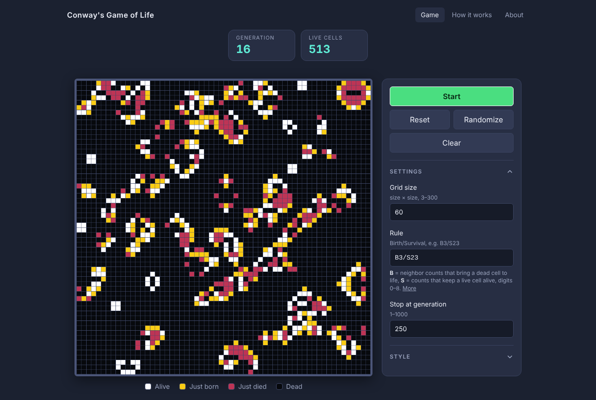
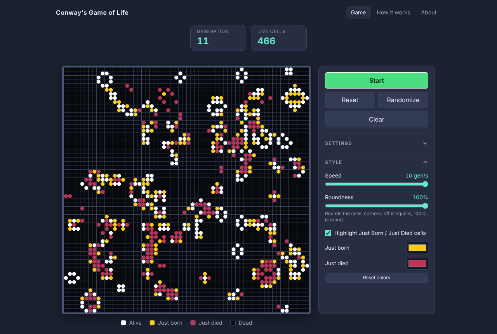
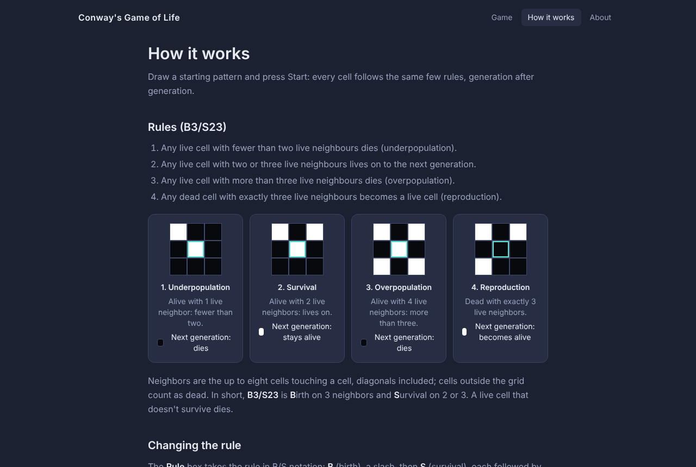

# Conway's Game of Life

**Live site:** https://mp-conways-game-of-life.netlify.app/

[Conway's Game of Life](https://en.wikipedia.org/wiki/Conway%27s_Game_of_Life) is a zero-player cellular automaton devised by John Horton Conway in 1970. Cells on a grid are alive or dead, and every generation each cell changes by its number of live neighbors:

1. A live cell with fewer than two live neighbors dies (underpopulation).
2. A live cell with two or three live neighbors lives on.
3. A live cell with more than three live neighbors dies (overpopulation).
4. A dead cell with exactly three live neighbors becomes alive (reproduction).

In B/S notation that is `B3/S23`, and this version lets you change it. Draw your own patterns, resize the grid and watch the generations unfold, all in the browser.

## Demo



*A running game, with cells that just changed highlighted.*



*Roundness and highlight colors under Style.*



*The How it works page explains the rules and the rule notation.*

## Layout

The game's logic lives in a single Python file, run in the browser with Pyodide. The page only draws the grid and forwards input.

```
mp-conways-game-of-life/
├── game_of_life.py        # the game (single source of truth)
├── test_game_of_life.py   # tests for the game
├── index.html             # game page
├── how-it-works.html      # rules and usage
├── about.html             # about and resources
├── js/
│   └── main.js            # drawing and input only
├── css/
│   ├── input.css          # Tailwind source and theme colors
│   └── styles.css         # generated by Tailwind
├── screenshots/           # images used in this readme
└── package.json           # Tailwind build and helper scripts
```

<details>
<summary>Development</summary>

    npm install           # only needed for the Tailwind build
    npm run serve         # serve over http, then open http://localhost:8000
    npm test              # python3 -m unittest -v
    npm run build:css     # rebuild css/styles.css (or npm run watch:css)

The page fetches `game_of_life.py`, so opening `index.html` directly will not work.

</details>

## License

[MIT](LICENSE)
